<picture>
  <source media="(prefers-color-scheme: dark)" srcset="assets/dark-v3.svg">
  <source media="(prefers-color-scheme: light)" srcset="assets/light-v3.svg">
  
</picture>

 

  
  

###

## Open Source Contributions

**[BabbleBeaver](https://github.com/open-build/BabbleBeaver)** (open-build): a privacy-focused conversational AI platform built on FastAPI that runs isolated LLM integrations in Docker. Jun–Aug 2024:
- Built a provider-agnostic LLM abstraction layer driven by a single config file, so developers can add OpenAI, Gemini, Ollama and other providers through config instead of hardcoded values ([#25](https://github.com/open-build/BabbleBeaver/pull/25), [#27](https://github.com/open-build/BabbleBeaver/pull/27))
- Added support for instruction/chat fine-tuned models in the config ([#26](https://github.com/open-build/BabbleBeaver/pull/26))
- Implemented conversation memory, with token usage tracking and history truncation to fit each model's context window ([#22](https://github.com/open-build/BabbleBeaver/pull/22))
- Added suggested prompts at the start of each chat session ([#23](https://github.com/open-build/BabbleBeaver/pull/23))
- Made the initial system prompt configurable instead of hardcoded ([#18](https://github.com/open-build/BabbleBeaver/pull/18))
- Documented model integration and local/Docker setup ([#28](https://github.com/open-build/BabbleBeaver/pull/28))
- Built the React frontend from scratch in [BabbleBeaverReact](https://github.com/open-build/BabbleBeaverReact), connecting it to the FastAPI backend, with suggested prompts that fetch responses when clicked
